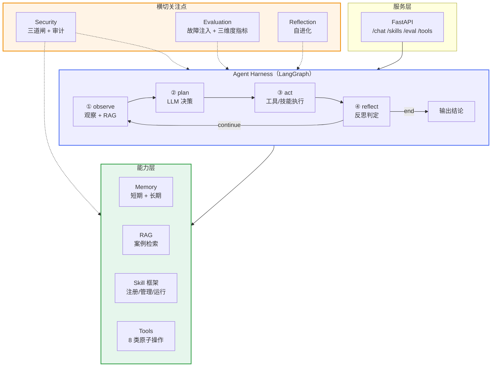
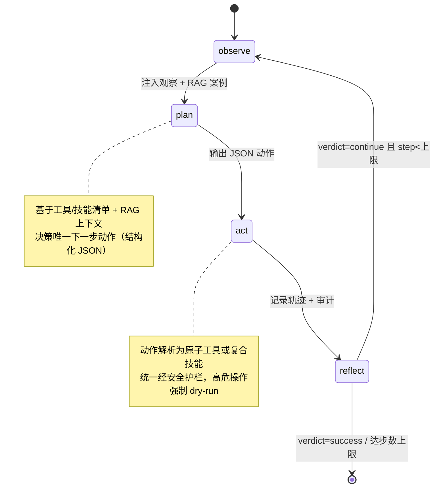

# PE-Agent · LLM 驱动的系统运维 Agent

> 面向操作系统救援场景的 LLM 自主运维智能体，将规则驱动的系统修复工具重构为具备「感知 → 规划 → 工具调用 → 反思 → 迭代」完整闭环的 Agent，并提供 Java 后端与 Web 前端，构成可交付的全栈系统。

[](https://www.python.org/)
[](https://www.langchain.com/langgraph)
[](https://fastapi.tiangolo.com/)
[](https://spring.io/projects/spring-boot)
[](https://vuejs.org/)
[](LICENSE)

---

## 目录

- [项目背景与简介](#项目背景与简介)
- [核心功能](#核心功能)
- [技术架构](#技术架构)
- [技术选型](#技术选型)
- [目录结构](#目录结构)
- [环境要求](#环境要求)
- [安装步骤](#安装步骤)
- [运行方式](#运行方式)
- [使用示例](#使用示例)
- [项目亮点与可扩展性](#项目亮点与可扩展性)
- [附：深度文档索引](#附深度文档索引)

---

## 项目背景与简介

PE（Preinstallation Environment）盘系统救援工具是操作系统运维中的常见场景：当目标机器无法启动时，从外部介质引导进入救援环境，对引导、文件系统、配置文件等进行诊断与修复。传统实现依赖硬编码的 `if-else` 分级故障诊断状态机，规则覆盖有限、难以处理未知故障，且无法从历史经验中学习。

本项目将这一规则驱动的工具重构为 **LLM 驱动的系统运维 Agent**：

- 将固化的诊断规则替换为 **LLM 推理决策**，使系统具备对未见故障的泛化能力；
- 引入 **反思（Reflection）与重试** 闭环，使修复过程能够自我纠正；
- 封装 **工具（Tool）与技能（Skill）** 体系，将底层系统操作标准化为 Agent 可调用的接口；
- 配套 **故障注入评测** 与 **运行时安全管控**，使 Agent 的能力可量化、行为可约束。

项目整体为三层全栈架构：**Vue3 前端 → Spring Boot（Java）后端 → Python Agent**，覆盖 Agent 研发、Java 后端与前端三个技术方向。

---

## 核心功能

| 能力 | 说明 |
|---|---|
| **自主修复闭环** | 基于 LangGraph 的四节点状态机，循环执行「观察 → 规划 → 执行 → 反思」，直至任务完成或达到步数上限 |
| **工具调用（Tool Use）** | 8 类原子系统操作（挂载/卸载、重装引导、文件系统修复、日志查询、配置读写、网络检测），声明式参数 Schema 供 LLM 结构化调用 |
| **技能框架（Skill）** | 将「指令 + 工具序列」封装为可复用、可版本化、可动态注册与启停的标准作业流程（SOP），上线前进行静态安全扫描 |
| **记忆（Memory）** | 短期轨迹缓冲（上下文窗口管理）与长期向量库（历史故障案例持久化），支持跨会话经验复用 |
| **检索增强（RAG）** | 检索历史相似故障案例，以 few-shot 形式注入决策上下文，加速根因定位与工具选择 |
| **反思迭代（Reflexion）** | 失败后生成语言反思并写入长期记忆，形成「失败 → 归因 → 复用」的自进化闭环 |
| **评测体系** | 故障注入评测集 + 三维度指标（完成度/安全性/鲁棒性）+ LLM-as-Judge 评分，量化 Agent 能力 |
| **安全管控** | 运行时三道闸（输入防注入、工具防越权、输出防泄露）+ 全链路审计，约束高危操作 |
| **全栈服务** | FastAPI 提供 Agent 接口；Spring Boot 提供业务编排、数据持久化与统一返回；Vue3 提供交互界面 |

---

## 技术架构



**分层说明：**

- **服务层**：FastAPI 对外暴露 REST 接口，是上层系统（含 Java 后端）的调用入口。
- **Agent Harness**：核心决策闭环，由 LangGraph 状态机承载，每个节点的输入输出均为可审计的状态。
- **能力层**：Memory、RAG、Skill、Tools 构成 Agent 的「记忆、知识与操作」基础。
- **横切层**：Security、Evaluation、Reflection 贯穿执行全链路，是工程化 Agent 与原型 Demo 的核心差异。

### Agent 决策闭环



| 节点 | 职责 |
|---|---|
| **observe** | 汇总系统状态与历史执行结果，检索相似案例注入上下文 |
| **plan** | 依据工具/技能清单决策下一步动作（结构化 JSON） |
| **act** | 解析动作 → 工具/技能 → 安全护栏 → 执行 |
| **reflect** | 判定成功/继续/换策略，叠加步数上限兜底防止失控 |

### 核心模块设计

| 模块 | 路径 | 设计说明 |
|---|---|---|
| Agent Loop | `graph/` | `StateGraph` 定义 4 节点 + 1 条件边；轨迹用 `Annotated[list, operator.add]` 追加归并；`verdict` 与 `max_iterations` 双重终止保障 |
| Tools | `tools/` | 工具声明 `params_schema` 与 `risk_level`，支持参数校验与结构化调用；`dry_run` 模式隔离真实环境风险 |
| Skill | `skills/` | 契约（manifest）/ 注册（registry）/ 管理（manager）/ 运行（runtime）四层；Tool 为原子能力，Skill 为复合 SOP；技能上线前静态安全扫描 |
| Memory | `memory/` | 短期 FIFO 缓冲防上下文溢出；长期向量库支持余弦相似度检索，可无缝替换 Chroma/FAISS |
| RAG | `rag/` | 历史案例检索 + few-shot 注入；嵌入层抽象，支持离线哈希与语义嵌入双模式 |
| Reflection | `reflection/` | 失败后生成语言反思并写入长期记忆，供后续检索复用 |
| Evaluation | `evaluation/` | 故障注入评测集 + 三维度指标 + LLM-as-Judge，支持黄金集校准 |
| Security | `security/` | 输入/工具/输出三道闸 + 全链路审计 |

---

## 技术选型

| 层 | 选型 | 理由 |
|---|---|---|
| Agent 编排 | **LangGraph** | 图状态机显式化决策流程，节点可观测、可回放、可断点续跑 |
| LLM | **DeepSeek / Qwen**（OpenAI 兼容） | 统一接口，工厂模式切换，支持离线 Mock 便于测试 |
| 服务层 | **FastAPI + Pydantic** | 原生异步、自动 OpenAPI 文档、类型校验 |
| Java 后端 | **Spring Boot 3 + MyBatis-Plus + H2** | 分层架构（Controller/Service/Mapper），H2 零安装，可平滑切换 MySQL |
| HTTP 客户端 | **WebClient** | Java 侧调用 Python Agent 的跨语言微服务通信 |
| 前端 | **Vue3 + Element Plus + Axios** | 主流前后端分离方案，Vite 构建与代理 |
| 检索/记忆 | 内置向量库（可换 Chroma/FAISS） | 初版零外部依赖，生产可无缝替换 |
| 评测 | 自建故障注入 + LLM-as-Judge | 对齐 Claw-Eval 三维度评分与 OpenJudge 思路 |

---

## 目录结构

```
PE_saver_agent/
├── src/pe_agent/        # Python Agent 核心
│   ├── core/            # 配置 / LLM 抽象 / Prompt 模板 / 嵌入层 / 工具函数
│   ├── graph/           # LangGraph 状态机（Agent Loop）
│   ├── memory/          # 短期记忆（轨迹缓冲）+ 长期记忆（向量库）
│   ├── rag/             # 故障案例检索增强
│   ├── skills/          # Skill 框架 + 内置技能
│   ├── tools/           # 原子系统工具
│   ├── reflection/      # Reflexion 反思模块
│   ├── evaluation/      # 评测集 + 指标 + LLM-as-Judge
│   ├── security/        # 安全管控（三道闸 + 审计）
│   └── api/             # FastAPI 服务层
├── java-backend/        # Java 后端（Spring Boot 3 + MyBatis-Plus + H2）
├── frontend/            # Vue3 前端（Vite + Element Plus + Axios）
├── scripts/             # demo.py / run_eval.py
├── tests/               # 单元测试（冒烟 / Skill 框架 / 安全）
├── docs/                # 架构、评测、调优、安全、选型等深度文档
├── pyproject.toml       # Python 项目元信息
└── requirements.txt     # Python 依赖清单
```

---

## 环境要求

| 组件 | 要求 |
|---|---|
| Python | ≥ 3.10 |
| Node.js / npm | ≥ 18 / 9 |
| JDK | ≥ 17（仅 Java 后端需要） |
| 数据库 | 无（Java 后端默认使用 H2 内存库） |

---

## 安装步骤

### 1. 获取代码

```bash
git clone https://github.com/x1Fan-lcx/PE_agent.git
cd PE_agent
```

### 2. 安装 Python 依赖

```bash
python -m venv .venv
source .venv/bin/activate          # Windows: .venv\Scripts\activate
pip install -e ".[dev]"
```

### 3. 配置 LLM（可选）

默认使用离线 Mock 模型，无需任何配置即可运行。接入真实模型时：

```bash
cp .env.example .env               # 编辑 .env，填入 LLM_API_KEY
```

支持任意 OpenAI 兼容接口（DeepSeek、Qwen、vLLM 等），仅需修改 `LLM_API_BASE` 与 `LLM_MODEL`。

### 4. 安装前端依赖

```bash
cd frontend
npm install
```

---

## 运行方式

项目为三端架构，需分别启动（依次执行）：

### 1. Python Agent（端口 8000）

```bash
PYTHONPATH=src python -m pe_agent.api.main
# 或 uvicorn pe_agent.api.main:app --port 8000
```

### 2. Java 后端（端口 8080）

```bash
cd java-backend
mvn spring-boot:run
```

### 3. 前端（端口 5173）

```bash
cd frontend
npm run dev
```

启动后访问 `http://localhost:5173` 使用 Web 界面；Agent 接口文档见 `http://127.0.0.1:8000/docs`。

### 离线验证（无需真实 LLM）

```bash
python scripts/demo.py       # 跑通「观察→规划→执行→反思」闭环
python scripts/run_eval.py   # 运行故障注入评测集，输出三维度指标
```

---

## 使用示例

### REST API 调用

```bash
# 健康检查
curl http://127.0.0.1:8000/health

# 发起系统救援
curl -X POST http://127.0.0.1:8000/chat \
  -H "Content-Type: application/json" \
  -d '{"goal": "电脑开机进入 grub rescue 界面，无法启动系统"}'
```

响应示例（节选）：

```json
{
  "finished": true,
  "final_answer": "已挂载根分区并重装 GRUB 引导，修复无法启动的问题",
  "trajectory": [
    {"action": "read_log", "message": "命中 grub 相关错误日志", "success": true},
    {"action": "mount_partition", "message": "模拟挂载 /dev/sda1", "success": true},
    {"action": "repair_boot", "message": "技能执行完成", "success": true}
  ]
}
```

### Java 后端接口

| 接口 | 方法 | 说明 |
|---|---|---|
| `/api/health` | GET | 健康检查 |
| `/api/repair` | POST | 转发故障描述至 Python Agent 并持久化 |
| `/api/records` | GET | 查询历史对话记录 |

### 支持的典型故障场景

- 引导故障（grub rescue / EFI 目录缺失）→ 重装引导；
- 文件系统损坏（EXT4-fs error）→ fsck 修复；
- 挂载失败（/boot 挂载失败）→ 分区挂载与配置修复。

---

## 项目亮点与可扩展性

### 项目亮点

1. **完整的 Agent 工程闭环**：覆盖决策（Planning）、工具调用（Tool Use）、记忆（Memory）、反思（Reflection）四大核心能力，而非仅调用对话 API。
2. **可量化的评测体系**：以 Claw-Eval 三维度评分（完成度/安全性/鲁棒性）+ 故障注入 + LLM-as-Judge，使 Agent 能力可测、可复现、可迭代。
3. **面向高危场景的安全设计**：提示注入拦截、危险命令过滤、挂载白名单、风险分级、dry-run 隔离、全链路审计六重防护。
4. **跨语言全栈架构**：Java 后端通过 WebClient 调用 Python Agent，演示了「业务服务 + AI 能力服务」解耦的微服务范式。
5. **工程规范化**：统一返回结构、参数 Schema 校验、单元测试覆盖、离线 Mock 可测试性，符合企业级交付标准。

### 可扩展性

- **工具层标准化**：现有 Tools 可封装为 MCP Server，接入主流 Agent 生态；
- **记忆与检索升级**：内置向量库可替换为 Chroma/FAISS/Milvus，嵌入层可升级语义模型并引入重排序；
- **多 Agent 协作**：状态机可扩展节点，支持并行诊断、多 Agent 分工；
- **数据飞轮**：失败轨迹可清洗回灌评测集与反思样本，形成自进化闭环；
- **模型升级路径**：评测轨迹可作为偏好数据，支持 SFT / RL（GRPO/DPO）迭代；
- **生产化改造**：H2 切换 MySQL、Redis 缓存、JWT 鉴权、流式输出、可观测性（LangSmith/OpenTelemetry）。

### Roadmap

- [x] v0.1 Agent 闭环 + Memory + RAG + Skill 框架 + 安全管控 + 评测
- [x] v0.2 接入真实 LLM、Java 后端与 Vue 前端初版
- [ ] v0.3 MCP Server 封装、流式输出、评测集扩充
- [ ] v0.4 反思调优（few-shot / prompt 优化）、LangSmith 观测
- [ ] v0.5 数据飞轮与多 Agent 协作

---

## 附：深度文档索引

| 文档 | 内容 |
|---|---|
| [docs/01_architecture.md](docs/01_architecture.md) | 架构与模块拆分 |
| [docs/02_evaluation.md](docs/02_evaluation.md) | 评测设计（Claw-Eval） |
| [docs/03_optimization.md](docs/03_optimization.md) | 调优（Reflexion / OpenJudge / 自进化） |
| [docs/04_security.md](docs/04_security.md) | 安全管控（A.I.G） |
| [docs/05_tech_selection.md](docs/05_tech_selection.md) | 技术选型调研 |
| [docs/06_methods_report.md](docs/06_methods_report.md) | 方法来源与设计依据 |
| [docs/07_resume.md](docs/07_resume.md) | 简历描述与写作范本 |
| [docs/08_java_plan.md](docs/08_java_plan.md) | Java 前后端融合设计 |
| [docs/09_java_run_guide.md](docs/09_java_run_guide.md) | 全栈运行指南 |

---

## License

[MIT](LICENSE)
