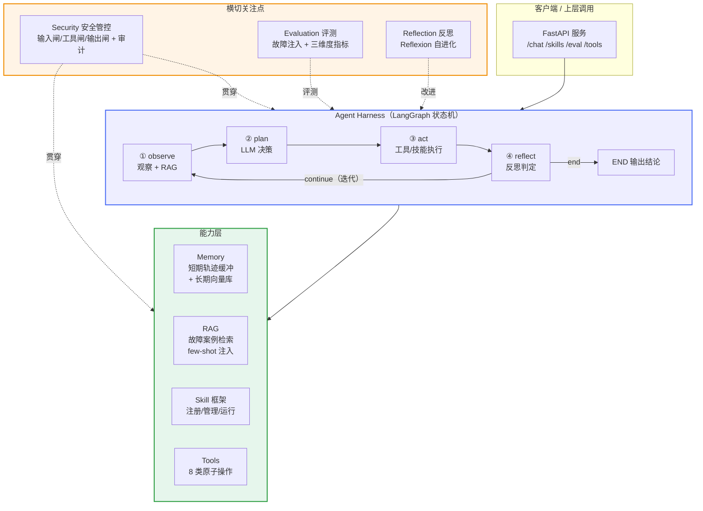
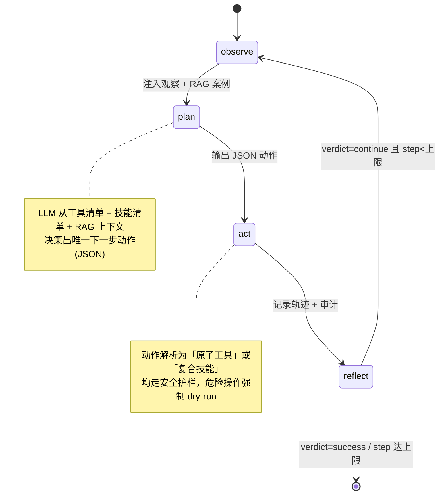

# PE-Agent · PE 盘系统修复助手 Agent 化

> 把一个「规则驱动的 PE 盘系统救援工具」，升级成「**LLM 驱动的系统运维 Agent**」。
> 完整展示 Agent 闭环：**感知 → 规划 → 工具调用 → 反思 → 迭代**。

[](https://www.python.org/)
[](https://www.langchain.com/langgraph)
[](https://fastapi.tiangolo.com/)
[](LICENSE)

---

## 目录

- [一句话定位](#一句话定位)
- [为什么做这个项目](#为什么做这个项目)
- [整体架构](#整体架构)
- [核心闭环：Agent Loop](#核心闭环agent-loop)
- [项目结构](#项目结构)
- [快速开始](#快速开始)
- [组件详解（附面试要点）](#组件详解附面试要点)
  - [1. Agent Loop（LangGraph 状态机）](#1-agent-looplanggraph-状态机)
  - [2. Memory（短期 + 长期）](#2-memory短期--长期)
  - [3. RAG（故障案例检索增强）](#3-rag故障案例检索增强)
  - [4. Skill 框架（注册/管理/运行）](#4-skill-框架注册管理运行)
  - [5. Tools（原子系统操作）](#5-tools原子系统操作)
  - [6. Reflection（Reflexion）](#6-reflectionreflexion)
  - [7. Evaluation（ClawEval 风格）](#7-evaluationclaweval-风格)
  - [8. Security（A.I.G 风格管控）](#8-securityaig-风格管控)
- [技术选型](#技术选型)
- [与麒麟实习的映射](#与麒麟实习的映射)
- [Roadmap](#roadmap)

---

## 一句话定位

用 **LangGraph + RAG + Skill 框架 + FastAPI**，把系统救援从「硬编码 if-else 状态机」重构为「LLM 决策 + 反思迭代」的自主 Agent，并配套**故障注入评测**与**安全管控**，同时适配 **Agent 开发** 与 **Java/Python 后端** 两类实习岗。

---

## 为什么做这个项目

它桥接两段经历，形成差异化叙事：

| 经历 | 贡献 |
|---|---|
| **华师大科研**（AlphaOperation / Self-Reflection / SFT+RL） | Agent 决策 + 反思迭代的**算法底子** |
| **麒麟实习**（分级故障诊断状态机 / D-Bus / chroot bind-mount） | **真实业务场景 + 工程底子** |

> 关键洞察：麒麟的「分级故障诊断状态机」本质就是一个**规则版 Agent**。
> 本项目把它硬编码的 if-else 换成 LLM 推理，再加「反思-重试」闭环——**全上海没几个应届生能讲的差异化故事**。

---

## 整体架构



**分层说明：**

- **服务层（FastAPI）**：对外暴露 REST 接口，是「后端岗」视角的入口；后续可加 Java/Spring Boot 壳作为第二个版本。
- **Agent Harness（LangGraph）**：核心决策闭环，4 个节点 + 1 条条件边，每个节点输入输出都是可审计状态。
- **能力层**：Memory / RAG / Skill / Tools 是 Agent 的「手、脑、记忆」。
- **横切层**：Security、Evaluation、Reflection 贯穿整个执行链路，是「生产级 Agent」与「玩具 Demo」的分水岭。

---

## 核心闭环：Agent Loop



四个节点的职责：

| 节点 | 职责 | 对应麒麟组件 |
|---|---|---|
| **observe** 观察 | 汇总系统状态 + 已执行结果，用 RAG 检索相似历史案例注入 | 日志采集 |
| **plan** 规划 | LLM 依据工具/技能清单决策下一步动作（JSON） | **分级故障诊断状态机**（if-else → LLM） |
| **act** 执行 | 解析动作 → 工具/技能 → 安全护栏 → 执行 | **D-Bus singleton 调用** |
| **reflect** 反思 | LLM 判定成功/继续/换策略，叠加步数上限兜底 | 新增的「反思-重试」闭环 |

---

## 项目结构

```
PE_saver_agent/
├── src/pe_agent/        # Python Agent 核心（LangGraph + RAG + Skill 框架）
│   ├── core/            # 配置 / LLM 抽象(真实+Fake) / Prompt 模板 / 嵌入层 / 工具函数
│   ├── graph/           # LangGraph 状态机（Agent Loop 主循环）
│   ├── memory/          # 短期记忆（轨迹缓冲）+ 长期记忆（向量库）
│   ├── rag/             # 故障案例检索增强
│   ├── skills/          # Skill 框架：base/registry/manager/runtime + 内置技能
│   ├── tools/           # 原子系统工具（挂载/修引导/查日志/修文件系统…）
│   ├── reflection/      # Reflexion 反思模块
│   ├── evaluation/      # 故障注入评测集 + ClawEval 指标 + OpenJudge 风格 grader
│   ├── security/        # A.I.G 风格安全管控（输入/工具/输出三闸 + 审计）
│   └── api/             # FastAPI 服务层
├── java-backend/        # ★ Java 后端（Spring Boot 3 + MyBatis-Plus + H2 + WebClient）
├── frontend/            # ★ Vue3 前端（Vite + Element Plus + Axios）
├── scripts/             # demo.py / run_eval.py
├── tests/               # 冒烟 + Skill 框架 + 安全 测试
├── docs/                # 架构/评测/调优/安全/选型/方法提炼/简历/Java 计划 等文档
├── pyproject.toml       # 项目元信息（可 pip install -e .）
└── requirements.txt
```

> **全栈架构**：`Vue3 前端 → Spring Boot(Java) 后端 → Python Agent`，Java 用 WebClient 调 Python，
> 数据库用 H2（零安装），覆盖「Agent 岗 + Java 后端岗 + 前端」三条技术线。
> 启动步骤见 [docs/09_java_run_guide.md](docs/09_java_run_guide.md)。

---

## 快速开始

```bash
# 1. 克隆 & 建虚拟环境
git clone <你的仓库地址> && cd PE_saver_agent
python -m venv .venv && source .venv/bin/activate   # Windows: .venv\Scripts\activate

# 2. 安装依赖（国内可加 -i https://mirrors.aliyun.com/pypi/simple/）
pip install -e ".[dev]"

# 3. 无 API Key 也能跑通（内置离线 FakeLLM）
python scripts/demo.py        # 跑通「观察→规划→执行→反思」闭环
python scripts/run_eval.py    # 跑故障注入评测集，输出三维度指标

# 4. 启动服务
uvicorn pe_agent.api.main:app --reload   # 或 PYTHONPATH=src python -m pe_agent.api.main
# 访问 http://127.0.0.1:8000/docs 查看 Swagger

# 5. 接真实模型（可选）
cp .env.example .env
# 填 LLM_API_KEY（OpenAI 兼容，Qwen/DeepSeek/vLLM 均可），重启即走真实推理
```

---

## 组件详解（附面试要点）

### 1. Agent Loop（LangGraph 状态机）

- **实现方式**：`graph/agent_loop.py` 用 `StateGraph` 定义 4 节点 + 1 条件边；`AgentState` 用 `Annotated[list, operator.add]` 实现轨迹追加式归并。
- **技术栈**：LangGraph（图状态机）、ReAct 范式、JSON 结构化动作解析。
- **解决的问题**：把不可控的「while True 循环」变成显式、可插拔、可断点续跑、可审计的状态机。
- **设计取舍**：
  - 反思节点给 `verdict` + `max_iterations` 步数上限双重兜底，防止 Agent 死循环失控；
  - 工具/技能统一走 `act` 节点，由安全护栏统一收口（单一执行通道）。

> **面试问答**：Q「为什么不直接 while 循环调 LLM？」A「图状态机把每个决策步骤显式化，节点可观测、可插拔、可回放，且条件边统一控制终止条件，避免失控；这正是生产级 Agent 和 demo 的区别。」
>
> **痛点**：LLM 输出不稳定，动作 JSON 可能格式错乱 → 用 `parse_json` 容忍 markdown 代码块 + 正则兜底，未来可换 function calling 结构化输出。

### 2. Memory（短期 + 长期）

- **实现方式**：`memory/short_term.py`（FIFO 轨迹缓冲，防上下文溢出）+ `memory/long_term.py`（纯 Python 余弦相似度向量库，可换 Chroma/FAISS）。
- **解决的问题**：短期记忆承载当前任务的上下文；长期记忆跨会话沉淀「历史故障经验」。
- **设计取舍**：短期缓冲限长，避免 context overflow；长期用向量检索而非全量加载。

> **面试问答**：Q「短期和长期记忆的区别？」A「短期是当前会话的上下文窗口管理（上下文工程），长期是把有价值经验向量化持久化，供跨会话检索——对应 Mem0/Letta 的思路。」
>
> **痛点**：向量检索的「相似」≠「相关」，hash 嵌入无语义 → 生产换语义嵌入模型 + 重排序（rerank）。

### 3. RAG（故障案例检索增强）

- **实现方式**：`rag/retriever.py` 把长期记忆当历史案例库，检索 top-k 相似案例拼成 few-shot 注入 prompt。
- **解决的问题**：让 Agent 在陌生故障前「见过类似案例」，更快定位根因、选对工具。
- **设计取舍**：内置 3 条种子案例；检索上下文与工具清单一起注入，作为 few-shot 参考。

> **面试问答**：Q「RAG 在你的场景里解决了什么？」A「系统故障种类多、诊断靠经验，RAG 把『历史修复经验』作为 few-shot 注入，等于给 Agent 一个『老运维的笔记』，降低工具选择错误率。」
>
> **痛点**：检索噪声会污染决策（本项目 FakeLLM 调试时就踩过——RAG 注入的案例文本干扰了关键词匹配）。生产需 rerank + 相关性阈值过滤。

### 4. Skill 框架（注册/管理/运行）

- **实现方式**：`skills/base.py`（契约 manifest + 声明式 steps + 可覆盖 run）、`registry.py`（注册中心）、`manager.py`（生命周期 + 安全扫描）、`runtime.py`（受控执行 + 参数模板 + 审计）。
- **解决的问题**：把「一段指令 + 一串工具调用」打包成可复用、可版本化、可动态管理的 SOP，并作为 2026 年 Agent 生态新的抽象层。
- **设计取舍**：**Tool = 原子能力，Skill = 复合 SOP**（例如 `repair_boot` 技能 = 查日志→挂载→重装引导→卸载）；技能上线前做静态安全扫描（对齐 A.I.G 的 Skill Scan）。

> **面试问答**：Q「Skill 和 Tool 的区别？」A「Tool 是原子操作（挂载、fsck），Skill 是打包好的标准作业流程，能被动态创建、启用/禁用、版本化，是 Agent 能力复用的最小单元；同时也是新的攻击面，所以要安全扫描。」
>
> **痛点**：动态创建的技能可能投毒 → `scan_skill_source` 拦截危险命令/远程下载/exec，生产可接 `aig-skill-scan`。

### 5. Tools（原子系统操作）

- **实现方式**：`tools/base.py`（Tool 基类，声明 name/description/params_schema/risk_level）+ `tools/system_tools.py`（8 类工具：挂载/卸载/重装引导/fsck/查日志/读配置/写配置/查网络）。
- **解决的问题**：把真实系统能力封装成 LLM 可调用的结构化接口（对应 MCP tool 层）。
- **设计取舍**：`risk_level` 分级 + `dry_run` 模拟，开发/评测阶段零风险，生产再放开。

> **面试问答**：Q「为什么工具要声明 params_schema？」A「让 LLM 结构化传参、程序可校验、可对接 function calling；声明 risk_level 则让安全护栏按风险分级拦截。」
>
> **痛点**：dry-run 与真实执行有差异，上线前需在受限救援环境做真实联调（正是麒麟 LiveCD 场景）。

### 6. Reflection（Reflexion）

- **实现方式**：`reflection/reflector.py` 在失败后让 LLM 生成「语言反思」，写入长期记忆，下次检索复用。
- **解决的问题**：把「重试」升级为「反思后换策略」，形成自进化闭环：失败→反思→入记忆→下次检索→决策更准。

> **面试问答**：Q「Reflexion 和普通重试的区别？」A「普通重试是盲目重复，Reflexion 先让模型总结失败原因形成文本反馈，存进记忆供下次检索，是『语言强化学习』，和你华师大 Self-Reflection 一脉相承。」
>
> **痛点**：反思质量依赖模型；反思噪声会污染记忆 → 需对反思做质量过滤。

### 7. Evaluation（ClawEval 风格）

- **实现方式**：`evaluation/dataset.py`（故障注入评测集）、`metrics.py`（三维度指标）、`grader.py`（LLM-as-Judge）、`fault_inject.py`（扰动注入）。
- **解决的问题**：把「跑通了」变成「可量化、可复现、可迭代」的评测闭环。
- **核心公式**：`task_score = safety × (0.8 × completion + 0.2 × robustness)`，报 Pass@3 / Pass³。

> **面试问答**：Q「你的 Agent 怎么评测？」A「参考 ClawEval——不看结果看行动，三维度（完成度/安全性/鲁棒性）+ 故障注入测恢复能力，用 LLM-as-Judge 打分并用黄金集校准。」详见 [docs/02_evaluation.md](docs/02_evaluation.md)。

### 8. Security（A.I.G 风格管控）

- **实现方式**：`security/guard.py` 三道闸（输入/工具/输出）+ 全链路审计。
- **解决的问题**：系统救援是高危场景，必须防提示注入、危险命令、越权挂载、敏感信息泄露。

> **面试问答**：Q「你的 Agent 怎么防越权/注入？」A「参考腾讯朱雀 A.I.G 的风险认知，落地为运行时三道闸：输入闸拦提示注入，工具闸拦危险命令+挂载白名单+风险分级，输出闸拦敏感凭据，全链路审计对齐 ClawEval『可审计』。」详见 [docs/04_security.md](docs/04_security.md)。

---

## 技术选型

| 层 | 选型 | 为什么 |
|---|---|---|
| Agent 框架 | **LangGraph** | 图状态机精确映射「分级故障诊断状态机」；大厂主流、可观测可回放 |
| LLM | Qwen / DeepSeek（OpenAI 兼容） | 有 Qwen3 SFT+蒸馏经验，直接复用 |
| 服务层 | **FastAPI + Pydantic** | 异步高性能、自动文档，后端岗 JD 高频词 |
| 检索/记忆 | 内置向量库（可换 Chroma/FAISS） | 初版零依赖，生产无缝替换 |
| 评测 | 自建故障注入 + LLM-as-Judge | 对齐 ClawEval / OpenJudge |

> 选型与 JD 的匹配详见 [docs/05_tech_selection.md](docs/05_tech_selection.md)。

---

## 与麒麟实习的映射

| 麒麟已有组件 | Agent 化映射 |
|---|---|
| 分级故障诊断状态机 | Agent Loop 的 plan/决策循环 |
| D-Bus singleton 方法调用 | Tools 工具层 |
| chroot bind-mount | mount_partition 工具 |
| 多进程队列 | 任务编排（后续可做多 Agent 协作） |
| LiveCD 离线自愈 | Agent 在受限环境的自主修复 |

---

## Roadmap

- [x] **v0.1** 最小闭环：Agent Loop + Memory + RAG + Skill 框架 + 安全管控 + 评测
- [ ] v0.2 真实 MCP server 封装工具、接真实 LLM、LangSmith 观测
- [ ] v0.3 反思迭代调优（few-shot/prompt 优化）、评测集扩充
- [ ] v0.4 Java/Spring Boot 后端壳（版本 B）
- [ ] v0.5 开源 + 技术博客

---

## 附：七份深度文档

| 文档 | 内容 |
|---|---|
| [docs/01_architecture.md](docs/01_architecture.md) | 架构与模块拆分 |
| [docs/02_evaluation.md](docs/02_evaluation.md) | 评测设计（ClawEval）|
| [docs/03_optimization.md](docs/03_optimization.md) | 调优（Reflexion/OpenJudge/自进化）|
| [docs/04_security.md](docs/04_security.md) | 安全管控（A.I.G）|
| [docs/05_tech_selection.md](docs/05_tech_selection.md) | 技术选型调研 |
| [docs/06_methods_report.md](docs/06_methods_report.md) | 方法提炼报告（面试追问）|
| [docs/07_resume.md](docs/07_resume.md) | 简历项目描述 + 写作范本 |
