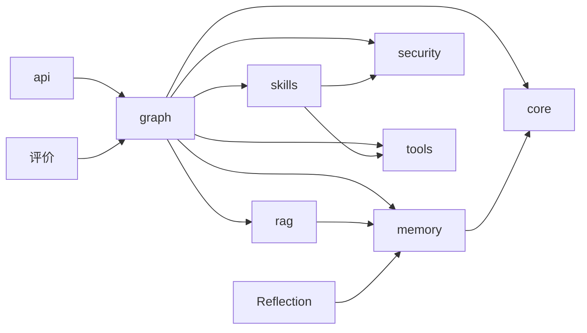

# 01 · 架构与模块拆分

> 本文回答：这个项目「由哪些模块组成、各自职责、为什么这么拆、面试怎么讲」。

## 1. 设计原则

1. **单一执行通道**：所有「动作」都经过 `act` 节点 + 安全护栏，杜绝旁路执行。
2. **能力与决策分离**：LLM 只做决策（plan/reflect），执行（tools/skills）与记忆（memory/rag）都是可替换的「能力层」。
3. **状态可审计**：`AgentState` 里的 `trajectory` 完整记录每一步动作与结果，支撑评测回放（对齐 ClawEval「执行过程可审计」）。
4. **离线可跑**：FakeLLM + 纯 Python 向量库，无 API key、无外部服务也能端到端跑通，方便 CI 与学习。

## 2. 模块清单

| 模块 | 路径 | 职责 | 关键类 |
|---|---|---|---|
| 配置 | `core/config.py` | 环境变量集中管理 | `Settings` |
| LLM 抽象 | `core/llm.py` | 统一模型接口，真实/Fake 双实现 | `ChatModel`/`OpenAIChatModel`/`FakeChatModel` |
| Prompt | `core/prompts.py` | 结构化决策/反思/评分模板 | `SYSTEM_PROMPT` 等 |
| 嵌入 | `core/embedder.py` | 语义嵌入（真实）+ hash 嵌入（离线） | `Embedder` 等 |
| Agent Loop | `graph/agent_loop.py` | 4 节点状态机 | `RepairAgent` |
| 状态 | `graph/state.py` | 共享状态定义 | `AgentState` |
| 短期记忆 | `memory/short_term.py` | 轨迹缓冲 | `ShortTermMemory` |
| 长期记忆 | `memory/long_term.py` | 向量案例库 | `LongTermMemory` |
| RAG | `rag/retriever.py` | 案例检索 + few-shot 注入 | `FaultCaseRAG` |
| Skill | `skills/*` | 技能契约/注册/管理/运行 | `Skill`/`SkillRegistry`/`SkillManager`/`SkillRuntime` |
| Tools | `tools/*` | 原子系统操作 | `Tool` 及 8 个子类 |
| Reflection | `reflection/reflector.py` | Reflexion 反思 | `ReflexionModule` |
| Evaluation | `evaluation/*` | 评测集/指标/grader/注入 | `EvalTask`/`compute_metrics`/`RubricGrader` |
| Security | `security/guard.py` | 三闸 + 审计 | `AgentGuard` |
| API | `api/*` | FastAPI 服务 | `app` |

## 3. 关键设计决策

### 3.1 为什么用 LangGraph 而不是手写循环？

- 状态机**显式化**：节点、边、条件路由都是声明式的，可读可测试。
- **可插拔**：后续加节点（如「人工确认」「多 Agent 协作」）不改主结构。
- **可观测/回放**：每个节点的输入输出都在 `AgentState`，天然支持 LangSmith 追踪。
- **可断点续跑**：支持 checkpoint，长时间任务可恢复。

### 3.2 为什么 Tool 和 Skill 分开？

- **Tool = 原子能力**（挂载、fsck），是 MCP 层的概念；
- **Skill = 复合 SOP**（`repair_boot` = 查日志→挂载→重装引导→卸载），是 2026 年 Agent 生态的新抽象。
- 分开后，技能能被动态创建、启用/禁用、版本化，也对应「新的攻击面」（A.I.G 专门做 Skill 扫描）。
- **命名规范**：原子工具用动词短语（`reinstall_bootloader`），复合技能用业务名词（`repair_boot`），避免重名歧义（本项目 v0.1 就踩过「工具技能重名导致技能永不触发」的坑）。

### 3.3 为什么反射节点要叠加步数上限？

- LLM 反思可能一直说「continue」，单靠反思判定会死循环。
- `max_iterations` 是**工程兜底**，保证任何情况下都能终止。

## 4. 依赖关系图

## 5. 面试可讲的「架构故事」

> 「我把 Agent 拆成三层：服务层（FastAPI）、Harness 层（LangGraph 四节点闭环）、能力层（Memory/RAG/Skill/Tools），外加横切的 Security 和 Evaluation。核心思想是**单一执行通道 + 状态可审计**——所有动作都经过 act 节点和护栏，轨迹完整可回放，所以我能评测它、也能安全地管控它。」
