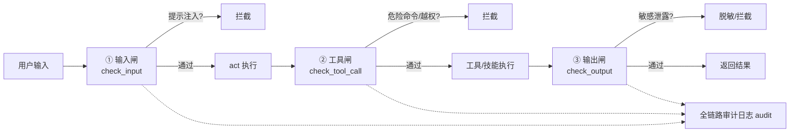

# 04 · 安全管控（参考腾讯朱雀 A.I.G）

> 本文回答：系统救援是高危场景，**怎么保证 Agent 不乱来、不越权、不被注入**。
> 参考腾讯朱雀实验室 A.I.G（AI-Infra-Guard）。

## 1. 参考对象：腾讯朱雀 A.I.G 在做什么

A.I.G（AI-Infra-Guard）是腾讯朱雀实验室开源的一站式 **AI 红队安全测试平台**，五大引擎：

| 引擎 | 能力 |
|---|---|
| Agent Scan | 扫描 Dify/Coze 等平台的 Agent 工作流安全 |
| **MCP & Skill Scan** | 审计 MCP Server 与 Agent Skills，**14 大类风险**（工具投毒、凭据泄露、命令注入等） |
| AI Infra Vuln Scan | 识别 vLLM/Ollama 等 100+ 组件、2000+ CVE |
| Jailbreak Evaluation | 大模型越狱评估（多轮 PAIR/GOAT 等） |
| ClawScan | OpenClaw 安全体检 |

其中 **Skill Scan 对齐 SkillTrustBench T01–T09**（指令劫持、记忆投毒、远程载荷下载执行、恶意代码、提权、持久化、工具伪装、不安全依赖、不安全编码）。

**关键认知**：A.I.G 是「红队/扫描」视角（上线前体检），本项目把它落成「防御/运行时」视角（执行中拦截）——同一套风险认知，A.I.G 负责「发现」，我们负责「拦住」。

## 2. 本项目的三道闸 + 审计（`security/guard.py`）

### ① 输入闸 `check_input` —— 防提示注入

检测「忽略以上指令」「ignore previous instructions」「system:」等注入特征。对应 A.I.G 的 Jailbreak 评估里对「提示注入」的关注。

### ② 工具闸 `check_tool_call` —— 防越权执行

- **危险命令拦截**：参数里含 `rm -rf / mkfs / dd if` 等直接阻断（critical）；
- **挂载白名单**：`mount_point` 必须在白名单前缀内，防误挂载任意分区；
- **风险分级 + dry-run 强制**：高风险操作在 dry-run 模式下强制只读模拟。

### ③ 输出闸 `check_output` —— 防敏感泄露

检测 AKIA/`sk-`/`-----BEGIN` 等凭据特征，防止把密钥、系统敏感信息带出去。

### 全链路审计 `audit`

每一次 plan/act 决策、工具调用、拦截都带时间戳落盘，对应 ClawEval 强调的「执行过程可审计」，也是事后溯源和评测回放的数据源。

## 3. 落地位置（代码 → 位置对照）

| 管控点 | 代码位置 |
|---|---|
| 输入护栏 | `graph/agent_loop.py` 的 `_act`（动作名/参数防注入）|
| 工具护栏 | `_act` 执行工具前 + `skills/runtime.py` 技能每步执行前 |
| 挂载白名单 | `config.py` 的 `safety_mount_whitelist` + `tools/system_tools.py` 兜底 |
| 危险命令 | `config.py` 的 `safety_dangerous_commands` |
| dry-run 强制 | `config.py` 的 `safety_dry_run`（生产务必 true）|
| 技能上线扫描 | `skills/manager.py` 的 `scan_skill_source`（对应 A.I.G Skill Scan）|
| 输出脱敏 | `security/guard.py` 的 `check_output` |

## 4. 面试问答要点

- **Q：你的 Agent 怎么做安全管控？** A：参考腾讯朱雀 A.I.G 的风险分类（工具投毒/命令注入/越权/提示注入），落成运行时三道闸 + 全链路审计；技能上线前做静态扫描（对齐 SkillTrustBench T01–T09）。
- **Q：为什么系统救援要特别强调安全？** A：挂载/修引导/改配置都是高危操作，一个误判可能毁掉用户数据，所以必须有「白名单 + 风险分级 + dry-run + 审计」四重防护。
- **Q：dry-run 的意义？** A：开发/评测阶段零风险模拟，生产才放开；高风险操作永远先模拟、后确认。
- **Q：技能投毒怎么防？** A：动态创建的技能先过 `scan_skill_source` 静态扫描（危险命令/远程下载/exec），高危直接拒绝注册；生产可接 `aig-skill-scan` 挂到 CI。
