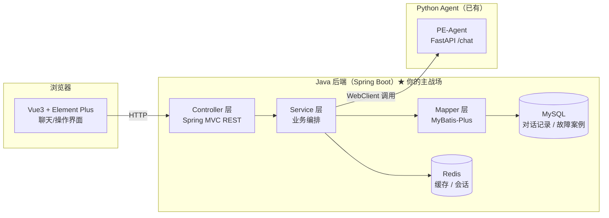

# 08 · Java 前端 + 后端 融合计划（待确认，未动手）

> **状态更新（2026-11-02）**：方案 A 的**初版已落地**（Phase 1–3 核心完成）。
> 代码在 `java-backend/`（Spring Boot）和 `frontend/`（Vue3），
> 启动步骤见 [docs/09_java_run_guide.md](09_java_run_guide.md)。下文保留完整设计思路供复盘。

> 目的：把 PE-Agent 从「纯 Python Agent」升级成「**Java 后端 + AI Agent**」的全栈项目，
> 用来投 **Java 开发岗**。

---

## 一、先厘清一个概念：Java 到底放哪

「前端融入 Java」通常有两条路，先帮你分清，你选一条：

| 路线 | 做法 | 优点 | 缺点 |
|---|---|---|---|
| **A. Java 做后端 + Vue 前端**（推荐） | Java(Spring Boot) 当后端，Vue3 做网页，Java 再调 Python Agent | 最主流、最像真实公司项目、JD 命中率最高 | 要碰一点前端 Vue |
| **B. 纯 Java 前端（Thymeleaf）** | 用 Thymeleaf 模板在 Java 里直接渲染页面 | 不碰 JS，纯 Java 技术栈 | 略"老派"，JD 里 Vue 更常见 |

> 结论：**推荐路线 A**。国内 Java 岗主流就是「Vue3 前端 + Spring Boot 后端 + MySQL」，这条最像真实工作，也最能撑起你的简历。

---

## 二、整体架构

**关键点**：Python Agent 保持不动，Java 通过 HTTP 把它当成一个「AI 能力服务」来调。这体现的是**跨语言微服务调用**能力——Java 岗面试官最爱听的故事：Java 后端负责业务/数据/接口，AI 能力由独立服务提供，两者解耦。

---

## 三、技术栈选型（Java 开发最常用的）

| 层 | 选型 | 为什么是它（JD 高频词） |
|---|---|---|
| 框架 | **Spring Boot 3.x** | Java 后端事实标准，几乎每个 Java 岗都要求 |
| Web | **Spring MVC / Spring Web** | REST 接口开发 |
| ORM | **MyBatis-Plus** | 国内最流行，SQL 可控、开发快（比 JPA 更常用） |
| 数据库 | **MySQL 8** | 最常用关系库 |
| 缓存 | **Redis** | 高频考点（缓存、会话、分布式锁） |
| 构建 | **Maven** | 最常用构建工具 |
| HTTP 客户端 | **WebClient / OpenFeign** | 调 Python Agent 用 |
| 简化 | **Lombok** | 消灭 getter/setter 样板代码 |
| 前端 | **Vue3 + Element Plus + Axios** | 国内最主流前后端分离组合 |

---

## 四、分阶段计划（每阶段可独立验收）

### Phase 1 · Java 后端最小打通（约 1–2 天）

**目标**：一个接口，把「故障描述」转发给 Python Agent，返回结果。

- 用 Spring Initializr 建项目（Maven + Spring Boot 3 + Web + Lombok）
- 一个 `POST /api/repair` 接口，接收 `{"goal": "..."}`，内部用 WebClient 调 Python 的 `/chat`
- 定义统一的返回结构 `Result<T>`（code/msg/data）
- **验收**：curl 调通，前端还没做

### Phase 2 · 数据层（约 1–2 天）

**目标**：把对话和结果落库，体现持久层能力。

- MyBatis-Plus 接入 MySQL
- 建两张表：
  - `repair_record`（对话记录：goal / 结果 / 轨迹 / 时间 / 状态）
  - `fault_case`（故障案例，后续可回灌给 Agent 的 RAG）
- **验收**：每次调用后数据库里有记录

### Phase 3 · 前端（约 2–3 天）

**目标**：一个能用的网页，输入故障、看到 Agent 的修复轨迹。

- Vue3 + Element Plus 搭聊天式界面
- 左侧输入故障描述，右侧流式/分步展示 Agent 轨迹（观察→规划→执行→反思）
- Axios 调 Java 后端 `/api/repair`
- **验收**：网页上跑通一个完整修复流程

### Phase 4 · 增强（可选，加分项）

- Redis 缓存热点结果
- 统一异常处理 + 参数校验（@Valid）
- 简单 JWT 登录（可选，展示鉴权能力）
- 把 `fault_case` 表数据导出喂给 Python Agent 的评测集

---

## 五、开工前需要你确认 4 件事

1. **路线**：选 A（Vue 前端）还是 B（纯 Thymeleaf）？—— 我推荐 A。
2. **JDK 版本**：你电脑装的是 JDK 8 / 11 / 17 / 21？Spring Boot 3 需要 JDK 17+。没装的话我给你装 JDK 17/21。
3. **数据库**：MySQL 装了吗？没装的话 Phase 2 先用 **H2 内嵌数据库**（零安装）跑，之后再切 MySQL。
4. **IDE**：你打算用 IDEA 还是别的？IDEA 是 Java 开发标配（社区版免费）。

---

## 六、为什么这个项目对 Java 岗有说服力

| 面试官问 | 你怎么答（项目支撑） |
|---|---|
| 会 Spring Boot 吗？ | 整个后端就是 Spring Boot 写的，Controller/Service/Mapper 三层 |
| 用过 MyBatis-Plus 吗？ | 对话记录、故障案例都是 MyBatis-Plus 落 MySQL |
| 会调第三方接口吗？ | Java 用 WebClient 调 Python Agent 的 REST 接口 |
| 做过前后端分离吗？ | Vue3 + Element Plus + Axios 调 Java 后端 |
| 懂 Redis 吗？ | 热点结果缓存（Phase 4） |

一句话总结你的差异化：**「Java 后端 + AI Agent 微服务」——别人只会 CRUD，你能讲清楚 Java 怎么和一个 LLM Agent 服务协作。**
